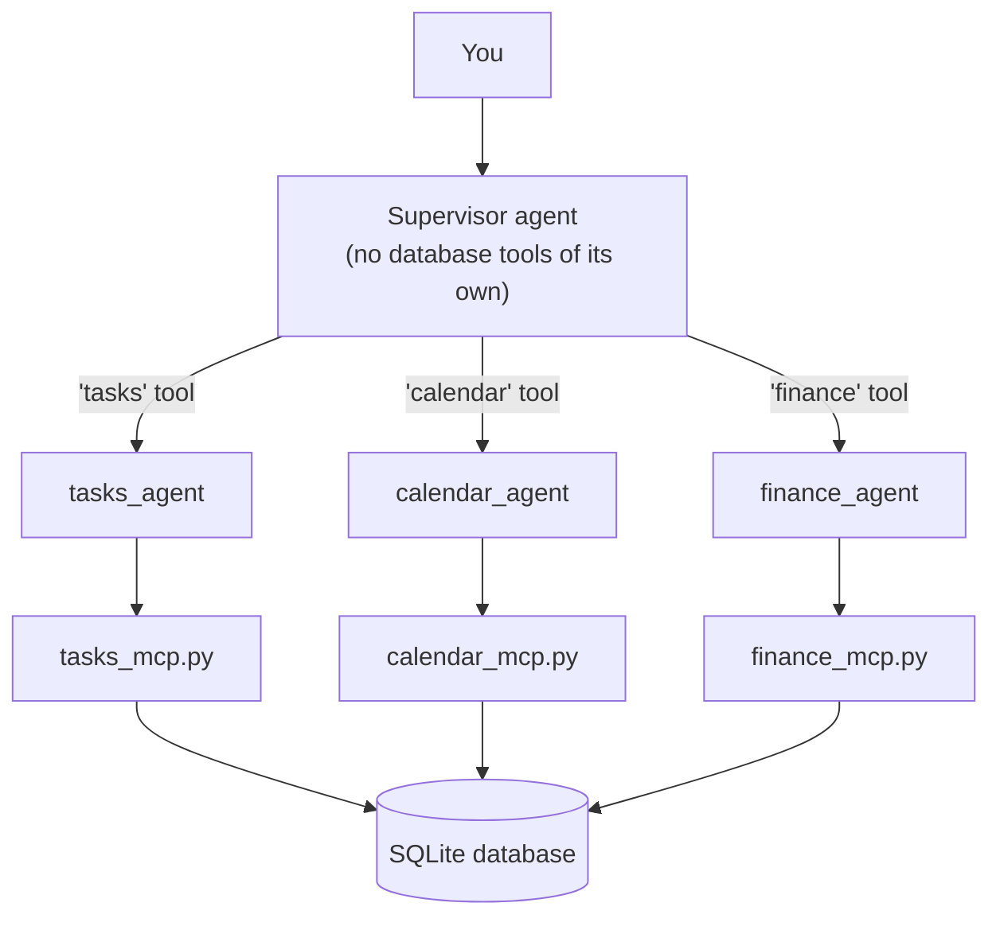

# Personal Life Admin Assistant — Multi-Agent Supervisor Edition

A fourth implementation of the same system, this time with more than one agent. The [three earlier versions](https://github.com/JoseIgnacioD/personal-life-ai-assistant) — [omp](https://github.com/JoseIgnacioD/personal-life-ai-assistant), [hand-built](https://github.com/JoseIgnacioD/personal-life-ai-assistant-custom-harness), [LangChain single-agent](https://github.com/JoseIgnacioD/personal-life-ai-assistant-langchain) — all used one agent holding every tool. This one splits that into a supervisor and three specialists, each restricted to its own domain.

## What this is

Instead of one agent with all ten tools, this version has:
- **Three specialist agents** — `tasks_agent`, `calendar_agent`, `finance_agent` — each seeing only its own three-or-four tools, with zero overlap between them.
- **One supervisor agent** — with no database tools of its own at all. Its only tools are three functions, each one a wrapped call to a specialist.

The pattern is LangChain's own officially documented one — a tutorial in their docs is literally titled *"Build a personal assistant using subagents, where a central main agent (supervisor) coordinates specialized worker agents,"* which is almost exactly this project's shape.

This project is deliberately self-contained: it doesn't import anything from the LangChain single-agent project, even though it started out sitting next to it. `supervisor_harness.py` has its own copies of `get_model()`, `extract_text()`, and the server config — a little duplication now, in exchange for this repo not silently depending on another one's internals.

## Architecture



The core mechanism, straight from LangChain's docs:

```python
subagent = create_agent(model, tools=[...])

@tool("name", description="...")
async def call_subagent(query: str) -> str:
    result = await subagent.ainvoke({"messages": [{"role": "user", "content": query}]})
    return extract_text(result["messages"][-1].content)

supervisor = create_agent(model, tools=[call_subagent, ...])
```

Each "tool" the supervisor sees is actually a full agent underneath — same shape as a normal tool call, except what runs on the other end is another `create_agent` loop with its own tools and its own turn of reasoning.

## What this actually proves, beyond the single-agent version

A single flat agent with ten tools can answer every question this system can answer — nothing here does something impossible any other way. What's different is structural:
- **Tool isolation**: `tasks_agent` cannot call `get_balance` even if it wanted to; the tool simply isn't in its list. Verified directly in the test suite.
- **A genuinely cross-domain question** — *"What's overdue, and can I afford $30 for dinner?"* — requires the supervisor to consult two specialists that have never seen each other's tools, and combine their separate answers into one reply.
- **A real trade-off**: this version's own tool-call trace is one layer further from view than the flat single-agent version's — the supervisor's decision to delegate isn't visible the way a direct tool call was in `harness.py`. Splitting responsibility bought isolation at the cost of transparency.

## Requirements

- Two Python environments, same split as the single-agent LangChain project: one for this project's own `.venv`, one (`SERVER_PYTHON`) that already runs the three MCP servers
- A Gemini API key

## Setup

1. **Find your server Python's path** (skip if already set from an earlier project) — `where python`, before creating this project's own venv.
2. **Create and activate this project's venv**
   ```bash
   python -m venv .venv
   .venv\Scripts\Activate.ps1
   ```
3. **Install dependencies**
   ```bash
   pip install -r requirements.txt
   ```
4. **Set environment variables** (skip any already set globally from earlier projects)
   ```bash
   setx SERVER_PYTHON "C:\path\to\your\other\python.exe"
   setx GEMINI_API_KEY "your-key-here"
   ```
5. **Seed the database**
   ```bash
   python init_db.py
   ```

## Usage

```bash
python supervisor_harness.py
```

Runs two demonstrations: a single-domain question (the supervisor delegates once) and a cross-domain question (the supervisor delegates twice and combines both answers).

## Testing

```bash
python tests/test_supervisor_harness.py
```

Three tests, in increasing order of what they prove: tool isolation between specialists, single-domain delegation, and the full cross-domain orchestration — with only the model's replies simulated; every tool call executes for real against the actual MCP servers.

## Project structure

```
langchain-multiagent/
├── schema.sql              # database schema (shared, unchanged from every earlier version)
├── init_db.py               # creates + seeds personal_assistant.db
├── tasks_mcp.py              # MCP server: tasks (unchanged)
├── calendar_mcp.py           # MCP server: calendar (unchanged)
├── finance_mcp.py            # MCP server: finance (unchanged)
├── supervisor_harness.py      # three specialists + one supervisor, self-contained
├── requirements.txt
└── tests/
    └── test_supervisor_harness.py
```

## What this practices

- **Multi-agent orchestration**, using LangChain's own documented subagents-as-tools pattern
- **The fourth piece of a matched set**: [omp](https://github.com/JoseIgnacioD/personal-life-ai-assistant), [hand-built](https://github.com/JoseIgnacioD/personal-life-ai-assistant-custom-harness), [LangChain single-agent](https://github.com/JoseIgnacioD/personal-life-ai-assistant-langchain), and this one — the same three MCP servers, four structurally different ways of deciding how to use them
- **A genuine trade-off, not just a new feature**: isolation between specialists came at the cost of visibility into what the supervisor is actually deciding
